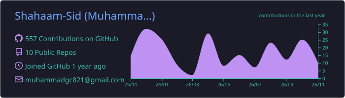
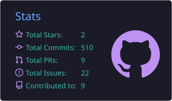
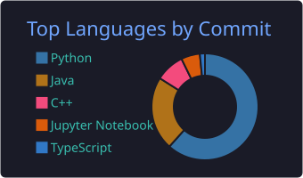
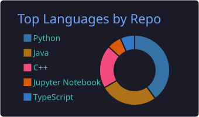
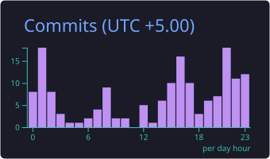

<!-- Header banner -->

  

  

 

  
  
  

---

## 👋 About Me

I'm **Muhammad Shahaam Siddiqui**, a Computer Science undergraduate (BSCS) at UBIT, Karachi, Pakistan, with a strong interest in **data science and AI/ML**. I enjoy turning data and ideas into working software, and I build projects across Python, Java and C++, from backend services and web apps to desktop tools and data analysis notebooks.

- 🎓 Studying Computer Science (BSCS) at UBIT
- 📊 Building my skills in data science, visualization and AI/ML
- 🛠️ Building portfolio projects across backend, web and desktop development
- 📫 Reach me at [muhammadgc821@gmail.com](mailto:muhammadgc821@gmail.com)

---

## 🧰 Tech Stack

  
  
  
  
  
  
  
  
  
  
  
  
  
  
  
  
  
  
  
  
  
  
  
  
  
  
  
  
  
  
  
  
  
  
  
  
  
  
  
  
  
  
  
  
  
  
  

---

## 📈 GitHub Stats

  
  

  
  

 

  
   
  

<!-- Footer banner -->

  

